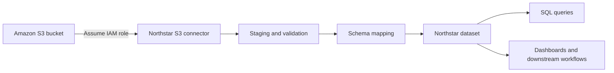

# Ingest data from Amazon S3

Use an Amazon S3 connector to ingest delimited files into Northstar Data Cloud. This guide walks through the complete setup: preparing a source file, creating a connector, mapping fields, scheduling synchronization and validating the resulting dataset with both SQL and the REST API.

At the end of the procedure, you will have a reusable ingestion pipeline that loads customer account data from an S3 bucket into a queryable Northstar dataset.

> **Example environment**
> 
> The product names, endpoints and account data in this repository are fictional. The workflow is designed to represent a production-style data platform implementation.

## Who should use this guide

Use this guide if you are responsible for one or more of the following:

- Connecting an external object store to a SaaS data platform
- Importing operational data for reporting or downstream workflows
- Mapping source fields to a governed dataset schema
- Validating ingestion results with SQL
- Testing ingestion jobs through an API

You should be comfortable navigating an AWS account and reading basic SQL. API validation is optional.

## Before you begin

You need:

- A Northstar role with **Data source: Create** and **Dataset: Create** permissions
- Access to an Amazon S3 bucket containing the source files
- An AWS IAM role that Northstar can assume
- A CSV file encoded as UTF-8
- A stable column header row

For this example, the S3 bucket contains a daily export named `customer_accounts_YYYY-MM-DD.csv`.

### Example source file

```csv
account_id,account_name,region,plan_tier,employee_count,updated_at
A-1001,Ardent Foods,CA,Enterprise,842,2026-09-30T22:41:13Z
A-1002,Northern Trail Labs,NY,Growth,216,2026-09-30T22:44:07Z
A-1003,Beacon Manufacturing,TX,Enterprise,1194,2026-09-30T22:47:51Z
```

Northstar uses the header row to propose a schema during connector setup. You can change field names and data types before the first ingestion run.

## How the ingestion flow works

The connector reads files from the configured S3 prefix, identifies files that have not already been processed and stages their contents for schema validation. Northstar then transforms the staged records into the destination dataset.



The initial load processes all matching files within the configured prefix unless you specify a start date. Later runs process only new objects whose keys match the file pattern.

## 1. Prepare the S3 source

Create a dedicated prefix for the dataset rather than mixing unrelated exports in the same path.

Recommended structure:

```text
s3://acme-analytics-prod/northstar/customer-accounts/
├── customer_accounts_2026-09-28.csv
├── customer_accounts_2026-09-29.csv
└── customer_accounts_2026-09-30.csv
```

Use a consistent file naming pattern. Avoid changing field names between daily exports unless you intend to update the destination schema.

### Source-file requirements

For this sample integration, source files must meet the following requirements:

| Requirement | Supported value |
| --- | --- |
| Format | CSV |
| Encoding | UTF-8 |
| Header row | Required |
| Maximum file size | 5 GB per object |
| Compression | None or gzip |
| Delimiter | Comma |
| Timestamp format | ISO 8601 recommended |

If a file contains malformed rows, Northstar records the rejected-row count in the ingestion run details. A small number of rejected rows can produce a `Warning` status; blocking schema errors produce a `Failed` status.

## 2. Create an IAM role for the connector

Create an AWS IAM role that grants read access only to the required bucket prefix.

A minimal read policy looks like this:

```json
{
  "Version": "2012-10-17",
  "Statement": [
    {
      "Effect": "Allow",
      "Action": [
        "s3:GetObject",
        "s3:ListBucket"
      ],
      "Resource": [
        "arn:aws:s3:::acme-analytics-prod",
        "arn:aws:s3:::acme-analytics-prod/northstar/customer-accounts/*"
      ]
    }
  ]
}
```

Do not grant write or delete permissions unless another workflow explicitly requires them.

During connector creation, Northstar provides an external ID. Add that external ID to the role trust policy before testing the connection. This prevents another account from using the role without the expected identifier.

## 3. Create the S3 connector

1. In Northstar, open **Data > Sources**.
2. Select **Add source**.
3. Select **Amazon S3**.
4. Enter a descriptive name such as `Production customer accounts`.
5. Enter the AWS IAM role ARN.
6. Enter the bucket name: `acme-analytics-prod`.
7. Enter the prefix: `northstar/customer-accounts/`.
8. For **File pattern**, enter `customer_accounts_*.csv`.
9. Select **Test connection**.

A successful test verifies that Northstar can assume the IAM role, list the configured prefix and read at least one matching object.

If the test fails, do not continue to schema setup. Confirm the role trust policy, bucket policy, prefix and object permissions first. See [Troubleshoot ingestion pipelines](troubleshooting-ingestion.md#connection-test-fails).

## 4. Define the destination dataset

After the connection test succeeds, select **Create dataset from source**.

Northstar samples the source files and proposes fields based on the header row and observed values.

For the example data, use the following destination schema:

| Source field | Destination field | Type | Nullable | Notes |
| --- | --- | --- | --- | --- |
| `account_id` | `account_id` | String | No | Primary business identifier |
| `account_name` | `account_name` | String | No | Display name |
| `region` | `region` | String | Yes | Two-letter region code |
| `plan_tier` | `plan_tier` | String | Yes | Subscription tier |
| `employee_count` | `employee_count` | Integer | Yes | Must be zero or greater |
| `updated_at` | `updated_at` | Timestamp | No | Parsed as UTC |

Set the dataset name to `customer_accounts`.

### Choose a record key

Set `account_id` as the record key.

The record key determines how Northstar identifies an existing record during incremental loads. When a later file contains the same `account_id`, Northstar updates the existing row rather than inserting a duplicate.

Choose a field that is:

- Stable over time
- Unique within the dataset
- Present on every record
- Independent of mutable display values such as a company name

## 5. Configure transformations

Use field-level transformations only when they make the destination schema more consistent or reliable.

For this example:

- Trim leading and trailing whitespace from `account_name`.
- Convert `region` to uppercase.
- Reject negative values in `employee_count`.
- Parse `updated_at` as UTC.

Do not use ingestion transformations to hide source-system quality problems that should be fixed upstream. A transformation should create a deliberate data contract, not silently repair unpredictable inputs.

## 6. Configure the ingestion schedule

For **Sync frequency**, select **Daily** and set the run time to `02:00 UTC`.

Enable **Run when a new matching file is detected** only if low-latency ingestion is required. Event-driven ingestion can increase run frequency and may be unnecessary for daily batch exports.

For the initial load, select **Process all matching files**.

Before saving, review:

- Bucket and prefix
- File pattern
- Record key
- Field mappings
- Transformations
- Schedule

Select **Save and run**.

## 7. Monitor the first ingestion run

Open **Data > Runs** and select the new ingestion run.

A successful run moves through these stages:

1. `Discovering files`
2. `Reading source`
3. `Validating schema`
4. `Transforming records`
5. `Writing dataset`
6. `Complete`

Review the following metrics before treating the dataset as ready for downstream use:

| Metric | What to check |
| --- | --- |
| Source files | Expected number of objects discovered |
| Rows read | Expected source record count |
| Rows written | Records successfully loaded |
| Rows rejected | Ideally zero; investigate unexpected values |
| Rows updated | Expected during incremental loads |
| Duration | Useful as a baseline for later performance changes |

If the run completes with `Warning`, open **Rejected rows** and review the failure reasons before enabling downstream automation.

## 8. Validate the dataset with SQL

After the run reaches `Ready`, query the dataset to confirm row counts, uniqueness and field transformations.

### Confirm that data was loaded

```sql
SELECT COUNT(*) AS row_count
FROM customer_accounts;
```

Compare the result with the expected number of distinct source accounts.

### Check for duplicate record keys

```sql
SELECT
  account_id,
  COUNT(*) AS occurrences
FROM customer_accounts
GROUP BY account_id
HAVING COUNT(*) > 1;
```

The query should return no rows.

### Validate the transformation rules

```sql
SELECT
  account_id,
  region,
  employee_count,
  updated_at
FROM customer_accounts
WHERE region <> UPPER(region)
   OR employee_count < 0
   OR updated_at IS NULL;
```

The query should return no rows.

### Compare plan-tier distribution

```sql
SELECT
  plan_tier,
  COUNT(*) AS accounts
FROM customer_accounts
GROUP BY plan_tier
ORDER BY accounts DESC;
```

Distribution checks are useful after migrations because an apparently successful load can still contain mapping mistakes that affect categories or enumerated values.

## 9. Validate the latest run with the API

You can also retrieve ingestion status programmatically.

Request:

```bash
curl --request GET \
  --url https://api.example.com/v1/ingestion-runs/run_01J8QX7H2K4W \
  --header "Authorization: Bearer $NORTHSTAR_API_TOKEN" \
  --header "Accept: application/json"
```

Example response:

```json
{
  "id": "run_01J8QX7H2K4W",
  "dataset_id": "ds_customer_accounts",
  "status": "complete",
  "started_at": "2026-10-01T02:00:03Z",
  "completed_at": "2026-10-01T02:02:41Z",
  "files_discovered": 1,
  "rows_read": 12481,
  "rows_written": 12481,
  "rows_rejected": 0,
  "rows_updated": 417
}
```

For endpoint details and error responses, see [Ingestion API reference](ingestion-api-reference.md).

## 10. Prepare for schema changes

Source schemas eventually change. Treat those changes as versioned contracts rather than assuming that ingestion will adapt safely.

Before adding, removing or changing a source field:

1. Identify downstream queries, dashboards and workflows that use the affected field.
2. Update the destination schema.
3. Test the new mapping against a representative source file.
4. Run validation queries in a non-production dataset.
5. Update dependent documentation and training material.
6. Promote the schema change to the production pipeline.

### Adding a nullable field

Adding a nullable field such as `industry` is usually backward compatible. Older rows can remain `NULL` until the source provides a value.

### Renaming a field

A rename can break queries and integrations. Prefer introducing the new field first, migrating consumers and removing the old field only after dependent workflows have been updated.

### Changing a data type

Treat type changes as potentially breaking. For example, converting `employee_count` from String to Integer will fail for non-numeric historical values unless you clean or remap them first.

## Migrate from manual CSV uploads

If your team currently uploads CSV files manually, migrate in stages rather than replacing the process in one step.

### Phase 1: Reproduce the existing dataset

Configure the S3 connector against the same exports used by the manual process. Load the data into a temporary dataset such as `customer_accounts_connector_test`.

Compare:

- Total row counts
- Record-key uniqueness
- Null rates
- Category distributions
- Minimum and maximum timestamps
- Representative records

### Phase 2: Parallel validation

Run manual uploads and the connector in parallel for at least one normal reporting cycle. Compare both outputs before changing downstream consumers.

### Phase 3: Cut over downstream workflows

Update dashboards, scheduled queries and integrations to use the connector-backed dataset.

Record the cutover date and retain the previous dataset for an agreed rollback period.

### Phase 4: Retire the manual process

After validation is complete:

- Disable manual upload permissions that are no longer required.
- Archive obsolete procedures.
- Update support and onboarding material.
- Confirm ownership for connector monitoring and source-schema changes.

## Operational recommendations

### Monitor rejected rows

A pipeline can continue to run while data quality gradually degrades. Review rejected-row counts as a percentage of total rows, not only as an absolute number.

A jump from 2 rejected rows to 200 may be meaningful even if the pipeline still reports `Warning` rather than `Failed`.

### Alert on stale datasets

Track the age of the most recent successful run. For a daily pipeline, a dataset that has not completed successfully in more than 24 hours should trigger investigation.

### Keep ownership explicit

Every production connector should have an owner responsible for:

- Source credentials and permissions
- Source schema changes
- Pipeline health
- Downstream impact assessment
- Documentation updates

### Use least-privilege access

The connector needs read access to source objects, not administrative access to the AWS account. Scope IAM policies to the minimum bucket and prefix required for the integration.

## Troubleshooting quick reference

| Symptom | Likely cause | Next step |
| --- | --- | --- |
| Connection test fails | IAM trust or S3 permissions | Verify role ARN, external ID and bucket policy |
| No files discovered | Prefix or file pattern mismatch | Compare configured pattern with actual object keys |
| Run fails during schema validation | Source field or type changed | Review schema diff and update mapping |
| Unexpected duplicate rows | Incorrect or missing record key | Validate key uniqueness and upsert configuration |
| Run completes with rejected rows | Invalid source values | Download rejection details and inspect source records |
| SQL count is lower than source count | Rejections or record-key updates | Compare rows read, written, rejected and updated |

For detailed procedures, see [Troubleshoot ingestion pipelines](troubleshooting-ingestion.md).

## Completion checklist

Before enabling the dataset for production use, confirm all of the following:

- [ ] The S3 connector passes its connection test.
- [ ] The source prefix and file pattern match only the intended exports.
- [ ] The destination schema uses explicit data types.
- [ ] A stable unique record key is configured.
- [ ] Transformations are documented and tested.
- [ ] The initial ingestion run completes successfully.
- [ ] SQL validation returns the expected counts and no duplicate keys.
- [ ] API status can be retrieved with the expected permissions.
- [ ] Schema-change ownership is defined.
- [ ] Monitoring is in place for failures, rejected rows and stale data.

Once these checks are complete, the `customer_accounts` dataset is ready for queries, dashboards and downstream workflows.
